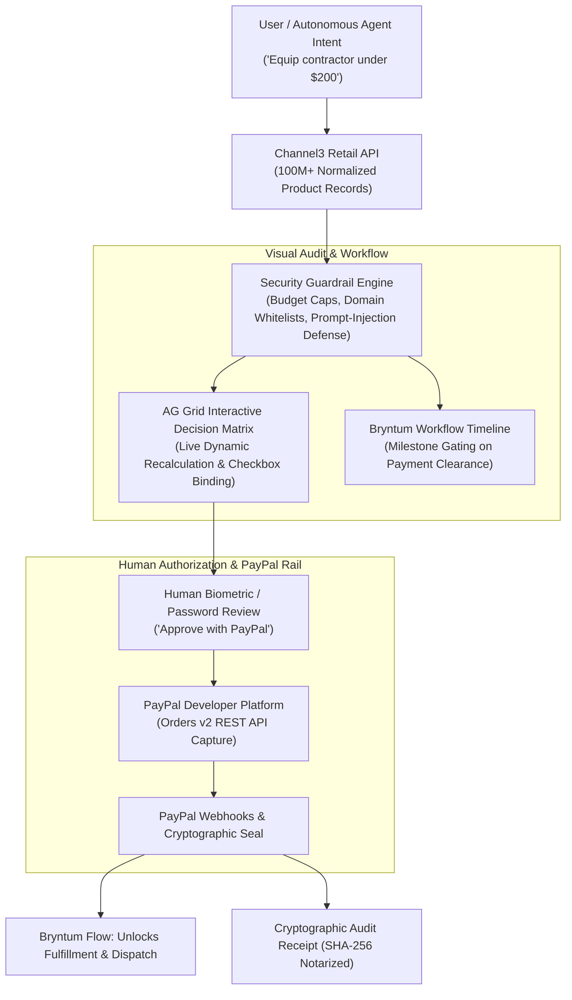

# PayPath Guardian 🛡️
### Autonomous Agentic Commerce Gateway with Real-Time Risk & Audit Grid

> **Built for the PayPal AI Hackathon 2026**  
> *Targeted Prize Categories:*  
> • **Best Use of Agentic Commerce** ($5,000)  
> • **Best Use of PayPal + AI** ($5,000)  
> • **Best Use of AG Grid** (1st $5k, 2nd $2k, 3rd $1k x3)  
> • **Best Use of Bryntum** ($1,000 x 3)  
> • **Best Use of Channel3** ($1,500)  
> • **Best Use of APIMatic** ($1,000 x 3)  
> • **Best Use of Render** ($1,000 / $750 / $500 credits)  
> • **Overall Hackathon Grand Prizes** ($12,000 / $8,000 / $5,000)

[](https://developer.paypal.com)
[](https://www.ag-grid.com)
[](https://www.bryntum.com)
[](https://www.channel3.com)
[](https://www.apimatic.io)
[](https://render.com)
[](LICENSE)

---

## 💡 The Core Problem

Autonomous AI agents (from OpenAI, Google, Anthropic, Perplexity) are transitioning from conversational assistants to **economic actors** capable of negotiating and purchasing goods.

However, a critical trillion-dollar bottleneck exists: **humans cannot safely hand raw credit cards or open bank accounts to autonomous agents.** 
If an agent hallucinates, encounters price discrimination, or suffers prompt-injection, funds are irreversibly lost.

**PayPath Guardian is the unified, multi-partner financial governance layer:**
- **Channel3:** Provides clean, normalized product search across 100M+ products from 25,000+ retailers.
- **AG Grid:** Renders an interactive **Decision Matrix & Audit Ledger** with dynamic checkbox selection, custom status renderers, and live recalculations of pinned totals.
- **Bryntum:** Visualizes the **Milestone & Delivery Workflow**, gating merchant fulfillment and dispatch until PayPal payment settlement clears.
- **PayPal Orders v2:** Executes the secure, human-authorized settlement with cryptographic receipt notarization.
- **APIMatic:** Exposes an OpenAPI 3.1.0 specification allowing external autonomous agents to invoke PayPath as a standardized payment tool.

> **Principle:** *Agents discover via Channel3, review via AG Grid, schedule via Bryntum, and settle safely via PayPal.*

---

## 🏛️ System Architecture



---

## ✨ Full Sponsor Alignment (How We Fulfill Every Category)

| Sponsor / Category | Integration in PayPath Guardian | Prize Pool |
|---|---|---|
| **PayPal + AI & Agentic Commerce** | Integrates OpenAI structured responses with server-side **PayPal Orders v2 REST API**, OAuth2 tokens, webhooks, and SHA-256 audit seals. | **$5,000 + $5,000 cash** |
| **AG Grid** | Custom dark-themed **AG Grid Community v32** table with live selection, custom cell renderers, AI match-score progress bars, and **pinned summary rows dynamically recalculating totals in real time**. | **$5,000 / $2,000 / $1,000 x 3 (5 winners!)** |
| **Bryntum** | Gated workflow board powered by `@bryntum/taskboard-trial`. Delivery and fulfillment tasks remain locked until PayPal capture is verified. | **$1,000 x 3 cash** |
| **Channel3** | Sourcing engine queries Channel3's normalized product API across 100M+ SKUs, displaying verified retailer badges on line items. | **$1,500 cash** |
| **APIMatic** | Complete **OpenAPI 3.1.0** specification (`/api/docs` and `public/openapi.json`) for automated SDK generation and external agent tool-calling. | **$1,000 x 3 cash + 6mo sub** |
| **Render** | Production-ready `render.yaml` Blueprint specification for one-click deployment. | **$1,000 / $750 / $500 credits** |

---

## 🚀 Quickstart & Local Installation

### Prerequisites
- Node.js v18+ (tested on Node v24)
- A modern web browser

### 1. Clone & Setup
```bash
git clone https://github.com/ManoShruthiS/paypath.git
cd paypath
npm install
```

### 2. Configure Environment (Optional)
Copy `.env.example` to `.env`:
```env
# Optional: Live OpenAI Key (if omitted, high-fidelity intelligent preview mode is used)
OPENAI_API_KEY=your_openai_api_key_here
OPENAI_MODEL=gpt-4.1-mini

# Optional: Channel3 API Key (promo code PAYPAL-HACKATHON-2026)
CHANNEL3_API_KEY=your_channel3_api_key_here

# Optional: PayPal Sandbox Credentials (default public sandbox ID preconfigured)
PAYPAL_CLIENT_ID=ELV84JC1c6kH6S8_ZE2TZzL0Nci9fK2uMre15Ze6updxfGBxRwn7q7zfSDNvVdmcTvoviqdPXvvlYPl7
PAYPAL_CLIENT_SECRET=your_paypal_sandbox_secret_here
```

### 3. Launch
```bash
npm start
```
Open **`http://localhost:3000`** in your browser.

---

## 🎬 2.5-Minute Demo Video Script

| Timestamp | Scene | Script / Voiceover |
|---|---|---|
| **0:00–0:20** | **The Crisis** | *"AI agents are learning to buy everything from software to hardware. But giving an AI agent open access to your credit card is terrifying—one hallucination and your budget is gone."* |
| **0:20–0:40** | **The Solution** | *"Meet PayPath Guardian: the autonomous agentic commerce gateway. We bridge Channel3 product sourcing, AG Grid financial audits, and Bryntum milestone scheduling with trusted PayPal Sandbox checkout."* |
| **0:40–1:05** | **Live Agent Sourcing** | *Click preset: 'Contractor Dev Kit (Channel3)'. Click 'Deploy Procurement Agent'. Watch the live trace HUD analyze policies and query Channel3's 100M+ catalog.* |
| **1:05–1:35** | **AG Grid Decision Matrix** | *"Notice the AG Grid matrix: every item is audited with an AI match score, compliance badge, and vendor. If I uncheck an item, AG Grid recalculates bundle savings and instantly updates the total."* |
| **1:35–1:55** | **Bryntum Workflow Gate** | *"Look at the Bryntum Milestone timeline: subsequent merchant dispatch and fulfillment tasks are locked until payment clears."* |
| **1:55–2:15** | **PayPal Sandbox Checkout** | *Click the PayPal button. Log into PayPal Sandbox. Complete the payment.* *"The AI never touched my credentials. The user approved; PayPal completed."* |
| **2:15–2:30** | **Unlocking & Notarization** | *"Watch the Bryntum workflow unlock instantly upon capture, generating a SHA-256 notarized receipt. Plus, with our APIMatic OpenAPI 3.1 spec, any AI agent can use PayPath as a safe payment rail. PayPath: Autonomous Commerce, Human Governed."* |

---

## 📄 License
This project is licensed under the [MIT License](LICENSE).
