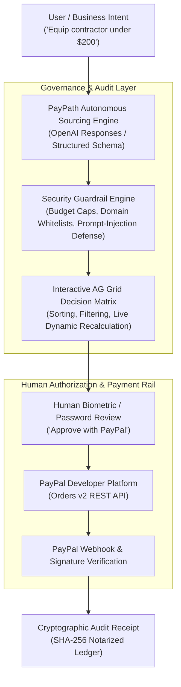

# PayPath Guardian 🛡️
### Autonomous Agentic Commerce Gateway with Real-Time Risk & Audit Grid

> **Built for the PayPal AI Hackathon 2026**  
> *Track Submissions:* **Best Use of Agentic Commerce** | **Best Use of PayPal + AI** | **Best Use of AG Grid** | **Best Use of APIMatic** | **Overall Grand Prize**

[](https://developer.paypal.com)
[](https://www.ag-grid.com)
[](https://www.apimatic.io)
[](LICENSE)

---

## 💡 The Core Problem

Autonomous AI agents (from OpenAI, Google, Anthropic, Perplexity) are transitioning from conversational assistants to **economic actors** capable of negotiating and purchasing goods.

However, a trillion-dollar bottleneck exists: **humans cannot safely hand raw credit cards or bank access to autonomous agents.** 
If an agent hallucinates, encounters price discrimination, or suffers prompt-injection, funds are irreversibly lost.

**PayPath Guardian is the missing financial governance layer:**
- **The AI Agent** discovers, optimizes, and audits multi-vendor proposals according to organizational policies.
- **AG Grid** provides a live, interactive **Decision Matrix & Audit Ledger** where humans review vendor trust, compliance scores, and dynamic bundle savings.
- **PayPal Sandbox Orders v2** executes the secure, human-authorized settlement with cryptographic receipt notarization.

> **Principle:** *Autonomous agents source and optimize; humans authorize; PayPal completes.*

---

## 🏛️ System Architecture



---

## ✨ Key Features & Sponsor Alignments

### 1. PayPal Developer Platform (Orders v2 & Sandbox Capture)
- Full server-side and client-side support for **PayPal Orders v2 API** (`/v2/checkout/orders`).
- Server-side tokenization, authorization, and capture flow with fallback resilience.
- Real-time webhook event handling (`PAYMENT.CAPTURE.COMPLETED`).
- Automatic generation of cryptographic SHA-256 sealed transaction audit receipts.

### 2. AG Grid Decision Matrix (Sponsor Track: Best Use of AG Grid)
- Custom-themed dark fintech data grid powered by **AG Grid Community v32**.
- **Interactive Checkboxes & Real-Time Dynamic Financials:** Deselecting or editing line items instantly recalculates volume bundle discounts, updates pinned summary totals, and dynamically binds the new amount to the PayPal checkout button.
- **Custom Cell Renderers:**
  - Compliance Status Badges (`✓ VERIFIED`, `★ OPTIMIZED`).
  - Animated AI Match Score bars with percentage telemetry.
  - Pinned bottom summary row aggregating live subtotal, savings, and net settlement total.

### 3. APIMatic Integration (Sponsor Track: Best Use of APIMatic)
- Standardized **OpenAPI 3.1.0** specification served at `/api/docs` and exported to `public/openapi.json`.
- Allows external autonomous multi-agent frameworks (LangChain, AutoGen, CrewAI) to invoke PayPath as a standardized payment tool.

---

## 🚀 Quickstart & Local Installation

### Prerequisites
- Node.js v18+ (tested on Node v24)
- A modern web browser

### 1. Clone & Setup
```bash
git clone https://github.com/ManoShruthiS/paypath.git
cd paypath
```

### 2. Configure Environment (Optional)
Copy `.env.example` to `.env`:
```env
# Optional: Live OpenAI Key (if omitted, high-fidelity intelligent preview mode is used)
OPENAI_API_KEY=your_openai_api_key_here
OPENAI_MODEL=gpt-4.1-mini

# Optional: PayPal Sandbox Credentials (default public sandbox ID preconfigured)
PAYPAL_CLIENT_ID=ELV84JC1c6kH6S8_ZE2TZzL0Nci9fK2uMre15Ze6updxfGBxRwn7q7zfSDNvVdmcTvoviqdPXvvlYPl7
PAYPAL_CLIENT_SECRET=your_paypal_sandbox_secret_here
```

### 3. Launch
```bash
npm start
```
Open **`http://localhost:3000`** in your browser.

---

## 🎬 2-Minute Demo Video Script

| Timestamp | Scene | Script / Voiceover |
|---|---|---|
| **0:00–0:20** | **The Crisis** | *"AI agents are learning to buy everything from software to hardware. But giving an AI agent open access to your credit card is terrifying—one hallucination and your budget is gone."* |
| **0:20–0:45** | **The Solution** | *"Meet PayPath Guardian: the autonomous agentic commerce gateway. We bridge autonomous AI sourcing with human-in-the-loop PayPal payments and AG Grid financial governance."* |
| **0:45–1:15** | **Live Agent Sourcing** | *Type preset: 'Equip a remote contractor with keyboard, mouse, and Copilot under $200'. Click 'Deploy Procurement Agent'. Watch the live trace HUD analyze policies and query verified merchants.* |
| **1:15–1:45** | **AG Grid Decision Matrix** | *"Notice the AG Grid matrix: every item is audited with an AI match score, compliance badge, and vendor. If I uncheck an item, AG Grid recalculates bundle savings and instantly updates the total."* |
| **1:45–2:15** | **PayPal Sandbox Checkout** | *Click the PayPal button. Log into PayPal Sandbox. Complete the payment.* *"The AI never touched my credentials. The user approved; PayPal completed."* |
| **2:15–2:30** | **Audit Receipt & APIMatic** | *"We receive an immutable SHA-256 cryptographically sealed receipt. Plus, with our OpenAPI 3.1 spec, any AI agent can use PayPath as a safe payment rail. PayPath: Autonomous Commerce, Human Governed."* |

---

## 🔒 Security & Responsible AI

- **Non-Custodial:** PayPath Guardian never stores credit card details or PayPal user passwords.
- **Human Sovereign Rail:** Autonomous agents can generate proposals, but payment requires explicit biometric or credential sign-off by the human buyer.
- **Audit Lineage:** Every settlement is cryptographically sealed with a SHA-256 digest registering the order ID, payer identity, itemized breakdown, and timestamp.

---

## 📄 License
This project is licensed under the [MIT License](LICENSE).
